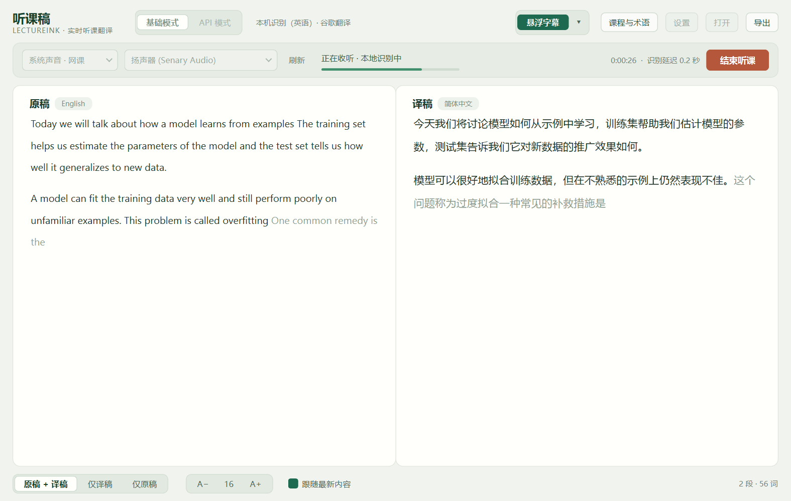

# 听课稿 · LectureInk

Windows 桌面实时听课翻译：边听边出原文和中文，可在视频上方开启悬浮字幕。

Real-time lecture transcription and Chinese translation for Windows, with a floating caption overlay.




截图使用合成语音（[tests/assets](tests/assets/README.md)），不含真实课堂内容。

## 下载

在 [Releases](https://github.com/Alan1112223331/LectureInk/releases/latest) 下载 `LectureInk-v0.2-Windows-x64.zip`，解压后运行 `LectureInk.exe`。操作步骤和常见问题见 [使用说明](使用说明.md)。

- 系统：Windows 10 / 11，64 位，不需要安装 Python。
- 程序没有代码签名，首次运行可能出现 Windows SmartScreen 提示。

## 两种模式

| | 基础模式 | API 模式 |
| --- | --- | --- |
| 识别 | 本机 Moonshine Medium Streaming（英语） | Soniox `stt-rt-v5`（多语言） |
| 翻译 | 谷歌翻译免费网页接口 | Soniox 同一连接内实时翻译 |
| 需要 | 首次下载约 260 MB 模型；能访问谷歌 | Soniox API Key（按用量计费） |
| 术语表 | 提高识别准确度；有译法的术语替换为指定译法 | 识别与翻译都使用，按指定译法翻译 |
| 延迟 | 识别约 0.3–0.6 秒，译文在句子结束后约 1 秒定稿 | 逐词返回，取决于网络 |

基础模式的谷歌接口无需密钥，但不是官方 API：可能限流，中国大陆网络通常无法直接访问。

## 显示方式

- **原稿与译稿分栏**：两栏的段落一一对应。可选并排、仅译稿或仅原稿。
- **连续成段**：句子接在同一段里，讲者停顿 2.5 秒以上才另起一段，不会一句一行。
- **逐词出现**：浅色文字是仍在变化的草稿，定稿后变为深色并保留在原位，不会从别处跳过来。
- **悬浮字幕**：置顶的半透明字幕条，最新内容在最下方，新的一行会平滑上推。
  - 拖动可移动位置，拖左右边缘可改宽度。
  - 双击切换是否显示原文；按住 Ctrl 滚动滚轮可调整字号。
  - 右键菜单可设置行数和背景深浅，或锁定为鼠标穿透（之后在主窗口“悬浮字幕”菜单里解锁）。

## 使用

1. 选择声音来源：网课选“系统声音”，现场选“麦克风”，再选具体设备。
2. 可选：在“课程与术语”里填写主题和术语，每行一个，例如 `overfitting = 过拟合`。
3. 点“开始听课”。需要时打开“悬浮字幕”。
4. 结束后点“结束听课”。文稿自动保存在 `%LOCALAPPDATA%\LectureInk\sessions`，可以导出为双语 HTML、Markdown 或 TXT。

API 模式先在“设置”里填写 Soniox API Key，也可以用环境变量 `SONIOX_API_KEY` 提供。选择记住密钥时，密钥会用 Windows DPAPI 加密保存。

## 数据去向

- **基础模式**：音频只在本机处理，不会上传。识别出的英文句子会发送给谷歌翻译。
- **API 模式**：音频实时上传到 Soniox；主题和术语作为识别上下文一并发送。
- **本机保存**：只保存文稿，不保存录音。

## 从源码运行

Windows x64，Python 3.13：

```powershell
python -m venv .venv
.\.venv\Scripts\python.exe -m pip install -r requirements.txt
.\.venv\Scripts\python.exe src\app.py
```

用音频文件代替声音设备，可以演示或复现问题：

```powershell
.\.venv\Scripts\python.exe src\app.py --audio-file tests\assets\lecture.wav --auto-start --overlay
```

运行测试并打包为单文件 EXE（输出到 `dist\single\LectureInk.exe`）：

```powershell
.\build.ps1
```

本地模型已下载时，测试会额外用 Moonshine 真模型跑一遍端到端检查；其余测试使用模拟接口，不联网。

## 第三方组件

见 [THIRD_PARTY_NOTICES.md](THIRD_PARTY_NOTICES.md)。
